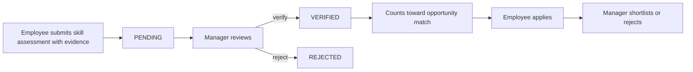
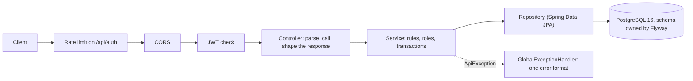
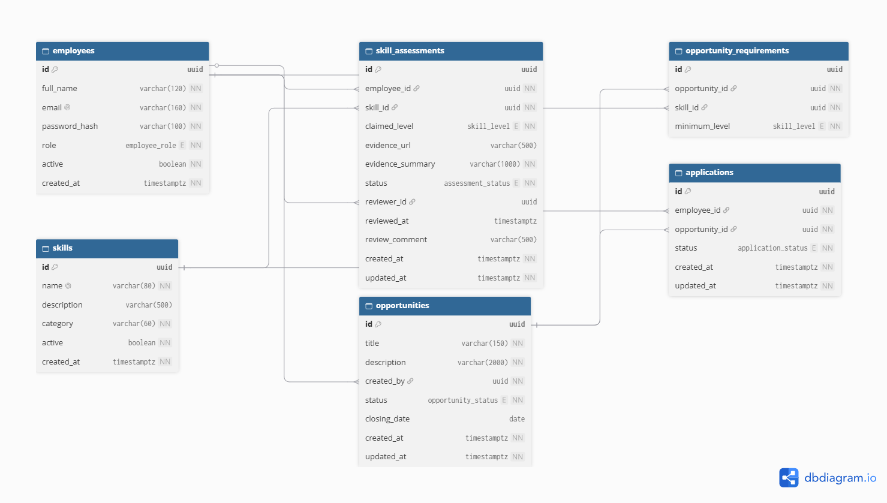

# SkillBridge API

**Evidence-backed skills and internal opportunities.** Employees prove what they can do, managers verify it, and internal roles are matched against *verified* skills only.

   

Built for **BuildLab Stage 1 (Backend Development)** by ANTHONY JERRY K. Everything runs locally: no cloud accounts, API keys or third-party services.

> This README describes the **Week 3** state, tagged `week-3`. Earlier snapshots are the `week-1` and `week-2` tags.

## The problem
Employees have no transparent path to internal growth, and hiring managers cannot tell who is qualified because skills are self-reported, unverified and scattered across records. SkillBridge makes a claim count only after someone else has verified the evidence.

## How it works


## Project status (Week 3 complete)
| Area | State |
|---|---|
| Design: one-pager, work plan, ERD, API spec, business rules | Done, see [documentation](#documentation) |
| Skill assessments, skills catalogue, opportunities, match, applications | Done (Weeks 1 and 2) |
| Registration, login, JWT, BCrypt, roles and ownership checks | Done (Week 2) |
| Automated tests: unit and integration against a real PostgreSQL | Done (Week 3): one command, see [Running the tests](#running-the-tests) |
| Pagination on every list endpoint and indexes on list queries | Done (Week 3), measured: [performance notes](docs/performance-notes.md) |
| Rate limiting on register and login, deliberate CORS | Done (Week 3): [security notes](docs/security-notes.md) |
| Endpoint documentation | [`docs/api-spec.md`](docs/api-spec.md) and a [Postman collection](postman/) |
| Hosted deployment | Not done, on purpose (see [Known limitations](#known-limitations)). A Docker run guide is provided |

## Architecture

- **Package by feature** under `com.skillbridge`: `auth`, `employee`, `skill`, `assessment`, `opportunity`, `application`, plus `security` (filter chain, JWT, current user) and `common` (errors, paging).
- **Thin controllers, rules in services.** Controllers resolve who is calling and shape the HTTP response. Every rule (roles, ownership, state changes) lives in a service, where unit tests can reach it.
- **DTOs at the boundary.** Requests and responses are Java records; entities are never returned.
- **Stateless.** No session and no cookie: a signed JWT in the `Authorization` header. The caller's role and active flag are re-read from the database on every request.

## Quick start

**Requirement:** [Docker Desktop](https://www.docker.com/products/docker-desktop/), running. Nothing else: no JDK, Maven or PostgreSQL. The first build needs internet and takes several minutes, so don't stop it if it looks quiet. Ports **8080** (API) and **5433** (database) must be free. A fuller guide with troubleshooting is in [`docs/setup-guide.md`](docs/setup-guide.md).

```bash
git clone --branch week-3 https://github.com/Antonijerry/skillbridge-api.git
cd skillbridge-api
cp .env.example .env        # Windows: copy .env.example .env
```
Set a signing key. The app **refuses to start** while `JWT_SECRET` in `.env` is the placeholder or shorter than 32 bytes:
```powershell
# Windows PowerShell
$b = New-Object byte[] 32
[Security.Cryptography.RandomNumberGenerator]::Create().GetBytes($b)
$secret = ($b | ForEach-Object { $_.ToString("x2") }) -join ""
(Get-Content .env) -replace '^JWT_SECRET=.*', "JWT_SECRET=$secret" | Set-Content .env
```
```bash
# macOS or Linux
sed -i "s/^JWT_SECRET=.*/JWT_SECRET=$(openssl rand -hex 32)/" .env
```
```bash
docker compose up --build
```
When the log shows `Started SkillbridgeApiApplication`, the API is on **http://localhost:8080** with its schema and demo data created. To run from source instead (JDK 21 and Docker): `docker compose up -d db`, then `./mvnw spring-boot:run` (`mvnw.cmd` on Windows).

Stop with `docker compose down`; add `-v` to also delete the local database.

## Demo accounts
Seeded **dummy data for this project only**; they share one demo password.

| Email | Role | Password |
|---|---|---|
| ada@skillbridge.local | EMPLOYEE | `Demo-Pass-123` |
| tunde@skillbridge.local | MANAGER | `Demo-Pass-123` |
| chidi@skillbridge.local | ADMIN | `Demo-Pass-123` |

Log in, then send the token as `Authorization: Bearer <token>`. A token lasts 60 minutes.

Try it (Windows PowerShell; on macOS or Linux use `curl`):
```powershell
$token = (curl.exe -s -X POST http://localhost:8080/api/auth/login -H "Content-Type: application/json" -d "@requests/login-ada.json" | ConvertFrom-Json).accessToken
curl.exe -s http://localhost:8080/api/employees/me -H "Authorization: Bearer $token"
curl.exe -i "http://localhost:8080/api/skills?page=0&size=2" -H "Authorization: Bearer $token"
curl.exe -i http://localhost:8080/api/skills
```
The third call shows the `X-Total-Count` header. The last call has no token and returns `401` in the standard error format.

The whole story (claim, verify, publish, match, apply, shortlist) runs two ways, both written for a **fresh database** (reset with `docker compose down -v`):
- **Postman:** import [`postman/skillbridge-api.postman_collection.json`](postman/) and run the collection.
- **PowerShell:** `powershell -ExecutionPolicy Bypass -File .\requests\w2-9-smoke.ps1` prints PASS or FAIL for 34 checks.

## Running the tests
```powershell
.\mvnw.cmd test        # macOS or Linux: ./mvnw test
```
- **Docker must be running.** The integration tests start a throwaway PostgreSQL 16 container (Testcontainers), run all Flyway migrations on it and discard it afterwards. They never touch your development database.
- A full run takes about 2 to 3 minutes (the first run also downloads the PostgreSQL image). The unit tests alone take seconds: `.\mvnw.cmd test "-Dtest=MatchServiceTest,ApplicationServiceTest"`.
- Last full run: **97 tests, 0 failures** (49 unit, 48 integration). What they cover, what they do not, and the measured coverage: [`docs/test-coverage.md`](docs/test-coverage.md).
- The same run writes a coverage report to `target/site/jacoco/index.html`.

## API
Every endpoint except register and login needs a bearer token. Full contract with examples: [`docs/api-spec.md`](docs/api-spec.md). OpenAPI file: [`docs/openapi.yaml`](docs/openapi.yaml).

Interactive docs: Swagger UI at `http://localhost:8080/swagger-ui.html`, generated from the controllers by springdoc-openapi (the raw document is at `/v3/api-docs`). Click **Authorize** and paste a token from `POST /api/auth/login` to try the protected endpoints. They are served without a token and can be switched off with `SWAGGER_ENABLED=false`.

| Area | Endpoints | Who |
|---|---|---|
| Auth | `POST /api/auth/register`, `POST /api/auth/login` | Anyone (register always creates an EMPLOYEE). Rate limited |
| Employees | `GET /api/employees/me`, `GET /api/employees/{id}/skill-assessments` | Yourself; MANAGER and ADMIN for others |
| Admin | `PATCH /api/employees/{id}/role`, `PATCH /api/employees/{id}/active` | ADMIN |
| Skills | `GET /api/skills`, `GET /api/skills/{id}`, `POST /api/skills` | Read: any user. Create: ADMIN |
| Assessments | `POST` and `GET /api/skill-assessments`, `GET`, `PUT` and `DELETE /api/skill-assessments/{id}`, `PATCH .../{id}/verify` and `/reject` | The owner edits while PENDING. MANAGER and ADMIN review |
| Opportunities | `POST` and `GET /api/opportunities`, `GET`, `PUT` and `DELETE /api/opportunities/{id}`, `POST .../{id}/requirements`, `DELETE .../{id}/requirements/{requirementId}`, `PATCH .../{id}/publish` and `/close` | Manage: creator or ADMIN. Create: MANAGER and ADMIN. Read published: any user |
| Match | `GET /api/opportunities/{id}/match` | Any user for themselves. MANAGER and ADMIN may add `?employeeId=` |
| Applications | `POST` and `GET /api/applications`, `PATCH /api/applications/{id}/shortlist`, `/reject`, `/withdraw` | Apply: any user. Review: the opportunity's creator or ADMIN. Withdraw: the applicant |

**Pagination.** Every list takes `page` (default 0) and `size` (default 20, maximum 100). The body stays a plain JSON array and the total is in the `X-Total-Count` header.

**Errors.** One format everywhere, and no response exposes a stack trace:
```json
{"error": {"code": "VALIDATION_ERROR", "message": "Invalid input", "details": [{"field": "email", "message": "must be a valid email address"}]}}
```

## Data model


Six entities: Employee, Skill, SkillAssessment, Opportunity, OpportunityRequirement, Application. Opportunity-to-Skill and Employee-to-Opportunity are many-to-many, through `opportunity_requirements` and `applications`. Migrations V1 to V6 create the schema, the demo data and the list indexes.

## Key decisions and the alternatives I rejected
| Decision | Alternative I rejected | Why |
|---|---|---|
| Identity comes only from the token; role and active flag are re-read from the database each request | Trust the role inside the token | A role change or deactivation must apply at once. Cost: one query per request |
| One login error for unknown email, wrong password and inactive account | A specific message for each | Different answers let an attacker discover which emails have accounts |
| History is kept: a rejected or verified claim is never edited, and at most one PENDING claim per employee and skill (partial unique index) | One row per employee and skill that is overwritten | Overwriting loses the audit trail and lets a self-promotion happen without review |
| The match percentage is computed on request from VERIFIED assessments only | Store a score on the opportunity | A stored score goes stale the moment a claim is verified or rejected |
| The database enforces the rules too (UNIQUE and CHECK constraints) | Rely on application code alone | Two simultaneous requests can both pass a code check; the constraint stops the second |
| Features reference each other by id; only an opportunity owns its requirements | JPA relationships everywhere | Keeps features independent and avoids loading whole object graphs (design decision 20) |
| Flyway owns the schema; Hibernate only validates | `ddl-auto: update` | Schema changes become reviewed, repeatable migrations |
| Tests run against a real PostgreSQL (Testcontainers) | H2 in memory | The schema uses a partial unique index, CHECK constraints, `gen_random_uuid` and `timestamptz`; H2 would pass tests that PostgreSQL rejects. Cost: Docker is needed to run tests |
| Offset pagination with `X-Total-Count` in a header | A wrapper object, or cursor paging | The array body keeps older clients working. Offset paging gets slower on very deep pages (documented) |
| The opportunity list is two queries (page, then requirements for those ids) | One query with an entity graph | A paged query that also fetches a collection is paged in memory by Hibernate, which defeats the paging |
| An in-memory rate limiter for the auth routes, keyed on the connection address | A library or gateway; trusting `X-Forwarded-For` | No new dependency and easy to test. Cost: per instance and reset on restart. The header is forgeable, so it is not trusted |
| Endpoint docs: a written spec (`docs/api-spec.md`) and a hand-written `docs/openapi.yaml`, plus Swagger UI generated from the code (springdoc) and a Postman collection | Generated docs only | The written spec has examples and the full error list; the generated one cannot drift from the code and has a test that checks it is served. Cost: two descriptions to keep in step, and the generated one does not know the 429 and 409 error codes unless annotated |

More in [`docs/design-decisions.md`](docs/design-decisions.md) and [`docs/business-rules.md`](docs/business-rules.md).

## Known limitations
- **No hosted deployment.** The seeded demo accounts share a documented password, so putting this on the internet as it stands would be unsafe. A Docker run guide is provided instead.
- **No HTTPS in the application.** TLS must be terminated in front of it.
- **No token revocation or refresh;** a token works until it expires or the account is deactivated.
- **The rate limiter is in memory** (per instance, reset on restart, fixed window).
- **Offset paging is slow on very deep pages.**
- A withdrawn application cannot be re-submitted (one application per employee and opportunity).
- Two reviewers acting on the same claim at the same instant: the last write wins.
- A URL with invalid percent-encoding returns the server's plain HTML 400 page.
- Tests do not cover concurrency, the employee role and active-status endpoints in depth, or some uncommon error handlers: [`docs/test-coverage.md`](docs/test-coverage.md) lists every known gap.

The full list with reasons: [`docs/issue-log.md`](docs/issue-log.md) and [`docs/security-notes.md`](docs/security-notes.md).

## Configuration
| Variable | Meaning | Default |
|---|---|---|
| `DB_NAME`, `DB_USER`, `DB_PASSWORD` | Database name, user and password (local dummy values) | `skillbridge`, `skillbridge`, `local_dev_password` |
| `DB_PORT` | Host port for PostgreSQL (5433 avoids a clash with a local PostgreSQL on 5432) | `5433` |
| `JWT_SECRET` | Token signing key, **at least 32 bytes**. The app will not start with the placeholder | `change-me` (too short on purpose: replace it) |
| `JWT_EXPIRY_MINUTES` | Optional: how long a token lasts | `60` |
| `RATE_LIMIT_AUTH_MAX` | Optional: register and login requests allowed per window and client address | `20` |
| `RATE_LIMIT_AUTH_WINDOW_SECONDS` | Optional: the window length | `60` |
| `CORS_ALLOWED_ORIGINS` | Optional: comma-separated browser origins allowed to call the API | none |

The optional variables are read from `.env` when you run from source. With Docker Compose they must also be listed under `app: environment:` in `docker-compose.yml`; see the setup guide.

## Troubleshooting
| Problem | Fix |
|---|---|
| The app exits at startup mentioning `skillbridge.jwt.secret` or a key that is too short | Set `JWT_SECRET` in `.env` (see Quick start) |
| Every request returns `401` | Log in again: tokens expire after 60 minutes |
| `429 TOO_MANY_REQUESTS` on login or register | More than 20 auth requests in a minute from one address. Wait for the `Retry-After` seconds, or raise `RATE_LIMIT_AUTH_MAX` for local scripts |
| `Could not find a valid Docker environment` when running the tests | Start Docker Desktop and wait until it reports running |
| `Bind for 0.0.0.0:8080 failed: port is already allocated` | Something else uses port 8080: `docker compose down` in any older copy, or stop the program using it |
| `port is already allocated` for the database | Change `DB_PORT` in `.env`, then `docker compose down` and start again |
| `password authentication failed` | You changed `DB_PASSWORD` after the first start (run `docker compose down -v`, which deletes only the local database), or another PostgreSQL uses your `DB_PORT` |
| `Cannot resolve placeholder 'DB_USER'` (running from source) | Create `.env` from `.env.example` in the repo root |
| In PowerShell, `curl` behaves oddly | Use `curl.exe` |
| The smoke script or Postman collection stops at the first claim | The database was already used once. Reset with `docker compose down -v` |

## Documentation
[Setup guide](docs/setup-guide.md) · [API spec](docs/api-spec.md) · [Test coverage](docs/test-coverage.md) · [Security notes](docs/security-notes.md) · [Performance notes](docs/performance-notes.md) · [Technical reflection](docs/technical-reflection.md) · [Declaration](docs/declaration.md) · [AI usage log](docs/ai-usage-log.md) · [One-pager](docs/idea-one-pager.md) · [Work plan](docs/work-plan.md) · [ERD](docs/erd.md) · [Business rules](docs/business-rules.md) · [Design decisions](docs/design-decisions.md) · [Issue log](docs/issue-log.md) · [Week 3 update](docs/update-week-3.md) · [Google Drive folder](https://drive.google.com/drive/folders/1ROEeMVWImOB_7qMYVerrN0eNHuI2byCL?usp=sharing)