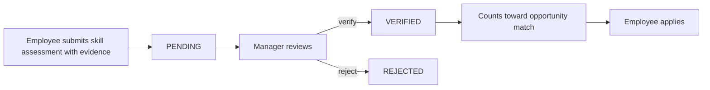

# SkillBridge API

**Evidence-backed skills and internal opportunities.** Employees prove what they can do, managers verify it, and internal roles are matched against *verified* skills only.

   

Built for **BuildLab Stage 1 (Backend Development)** by ANTHONY JERRY K. Everything runs locally: no cloud accounts, API keys or third-party services.

> This README describes the **Week 2** state, tagged `week-2` and kept on the `week-2` branch. The Week 1 snapshot is the `week-1` tag.

## The problem
Employees have no transparent path to internal growth, and hiring managers cannot tell who is qualified because skills are self-reported, unverified and scattered across records. SkillBridge makes a claim count only after someone else has verified the evidence.

## How it works


## Project status (Week 2 complete)
| Area | State |
|---|---|
| Design: one-pager, work plan, ERD, API spec, business rules | Done, see [documentation](#documentation) |
| Skill assessments: claim, edit, withdraw, verify, reject | Done (Week 1, now behind authentication) |
| Registration, login, JWT, BCrypt password hashing | Done (Week 2) |
| Roles (EMPLOYEE, MANAGER, ADMIN), ownership checks, admin account management | Done (Week 2) |
| Skills catalogue | Done (Week 2) |
| Opportunities with required skills, DRAFT to PUBLISHED to CLOSED | Done (Week 2) |
| Match percentage and applications | Done (Week 2) |
| One error format and validation on every endpoint | Done (Week 2) |
| Automated tests, OpenAPI documentation, deployment | Planned for Week 3 |

## Quick start

**Requirement:** [Docker Desktop](https://www.docker.com/products/docker-desktop/), running. Nothing else: no JDK, Maven or PostgreSQL. The first build needs internet and takes several minutes (it downloads images and dependencies), so don't stop it if it looks quiet. Later starts take seconds. Ports **8080** (API) and **5433** (database) must be free.

### Option 1: Docker only (recommended)
```bash
git clone --branch week-2 https://github.com/Antonijerry/skillbridge-api.git
cd skillbridge-api
cp .env.example .env        # Windows: copy .env.example .env
```
Now set a signing key. The app **refuses to start** while `JWT_SECRET` in `.env` is the placeholder or shorter than 32 bytes. Generate a random one and put it on the `JWT_SECRET=` line of `.env`:

```powershell
# Windows PowerShell
$b = New-Object byte[] 32
[Security.Cryptography.RandomNumberGenerator]::Create().GetBytes($b)
$secret = ($b | ForEach-Object { $_.ToString("x2") }) -join ""
(Get-Content .env) -replace '^JWT_SECRET=.*', "JWT_SECRET=$secret" | Set-Content .env
```
```bash
# macOS or Linux
sed -i "s/^JWT_SECRET=.*/JWT_SECRET=$(openssl rand -hex 32)/" .env
```
Then start everything:
```bash
docker compose up --build
```
When the log shows `Started SkillbridgeApiApplication`, the application is listening on **http://localhost:8080** and its database schema and demo data are created. The database values in `.env` are local dummy values and work as they are.

### Option 2: Run from source (developers)
Requires JDK 21 and Docker. Create `.env` and set `JWT_SECRET` as above, then:
```bash
docker compose up -d db
./mvnw spring-boot:run      # Windows: mvnw.cmd spring-boot:run
```

Stop everything with `docker compose down`. Add `-v` to also delete the local database (this erases all data, including anything you created while trying the API).

## Demo accounts
These accounts are seeded **dummy data for this project only**. They share one demo password.

| Email | Role | Password |
|---|---|---|
| ada@skillbridge.local | EMPLOYEE | `Demo-Pass-123` |
| tunde@skillbridge.local | MANAGER | `Demo-Pass-123` |
| chidi@skillbridge.local | ADMIN | `Demo-Pass-123` |

Log in, then send the token as `Authorization: Bearer <token>`. A token lasts 60 minutes.

Try it (Windows PowerShell; on macOS or Linux use `curl` instead of `curl.exe`):
```powershell
curl.exe -s -X POST http://localhost:8080/api/auth/login -H "Content-Type: application/json" -d "@requests/login-ada.json"
$token = (curl.exe -s -X POST http://localhost:8080/api/auth/login -H "Content-Type: application/json" -d "@requests/login-ada.json" | ConvertFrom-Json).accessToken
curl.exe -s http://localhost:8080/api/employees/me -H "Authorization: Bearer $token"
curl.exe -s http://localhost:8080/api/skills -H "Authorization: Bearer $token"
curl.exe -i http://localhost:8080/api/skills
```
The last command has no token and returns `401` in the standard error format.

The whole story (claim, verify, publish, match, apply, shortlist) is ready to run two ways, both written for a **fresh database** (a second pass hits the "already verified" rule; reset with `docker compose down -v`):
- **Postman:** import [`postman/skillbridge-api.postman_collection.json`](postman/) and run the collection. It has a login step and saves the tokens itself.
- **PowerShell:** `powershell -ExecutionPolicy Bypass -File .\requests\w2-9-smoke.ps1` prints PASS or FAIL for 34 checks.

More request bodies are in [`requests/`](requests/).

## API
Every endpoint except register and login needs a bearer token. Full contract: [`docs/api-spec.md`](docs/api-spec.md).

| Area | Endpoints | Who |
|---|---|---|
| Auth | `POST /api/auth/register`, `POST /api/auth/login` | Anyone (register always creates an EMPLOYEE) |
| Employees | `GET /api/employees/me`, `GET /api/employees/{id}/skill-assessments` | Yourself; MANAGER and ADMIN for others |
| Admin | `PATCH /api/employees/{id}/role`, `PATCH /api/employees/{id}/active` | ADMIN |
| Skills | `GET /api/skills`, `GET /api/skills/{id}`, `POST /api/skills` | Read: any user. Create: ADMIN |
| Assessments | `POST` and `GET /api/skill-assessments`, `GET`, `PUT` and `DELETE /api/skill-assessments/{id}`, `PATCH .../{id}/verify` and `/reject` | The owner edits while PENDING. MANAGER and ADMIN review |
| Opportunities | `POST` and `GET /api/opportunities`, `GET`, `PUT` and `DELETE /api/opportunities/{id}`, `POST .../{id}/requirements`, `DELETE .../{id}/requirements/{requirementId}`, `PATCH .../{id}/publish` and `/close` | Manage: creator or ADMIN. Create: MANAGER and ADMIN. Read published: any user |
| Match | `GET /api/opportunities/{id}/match` | Any user for themselves. MANAGER and ADMIN may add `?employeeId=` |
| Applications | `POST` and `GET /api/applications`, `PATCH /api/applications/{id}/shortlist`, `/reject`, `/withdraw` | Apply: any user. Review: the opportunity's creator or ADMIN. Withdraw: the applicant |

Every error uses one format, and no response exposes a stack trace:
```json
{"error": {"code": "VALIDATION_ERROR", "message": "Invalid input", "details": [{"field": "email", "message": "must be a valid email address"}]}}
```

## Data model


Six entities: Employee, Skill, SkillAssessment, Opportunity, OpportunityRequirement, Application. Opportunity-to-Skill and Employee-to-Opportunity are many-to-many, through `opportunity_requirements` and `applications`. All six tables exist (migrations V1 to V5).

## Engineering decisions
- **Identity comes from the token, never from the request body.** The role and the active flag are re-read from the database on every request, so a deactivated account stops working immediately and a role change applies at once.
- **Passwords are stored as BCrypt hashes** and are never logged. Login gives the same `401` for an unknown email, a wrong password and an inactive account.
- **Checks run in a fixed order:** wrong role is `403`, then a missing record is `404`, then wrong ownership is `403`.
- **The database enforces the rules too.** At most one open (PENDING) claim per employee and skill (a partial unique index; history is kept), one requirement per skill per opportunity, one application per employee and opportunity. These are UNIQUE and CHECK constraints, so bad data cannot get in even if application code has a bug.
- **Verified claims are never edited.** VERIFIED and REJECTED assessments are immutable history; a rejected employee resubmits, and a higher level is a new claim, so no one can promote themselves without review.
- **The match percentage is computed on request** from VERIFIED assessments only, never stored, and is rounded down.
- **Flyway owns the schema.** Hibernate only validates it (`ddl-auto: validate`). Schema changes are new migrations, never edits to an applied one.
- **Layered, package-by-feature structure.** Controller, service and repository per feature; DTOs at the API boundary, entities never exposed. Features reference each other by id; only an opportunity owns its requirements.
- **Secrets stay out of Git.** Configuration comes from environment variables; only `.env.example` is committed.

More in [`docs/design-decisions.md`](docs/design-decisions.md) and [`docs/business-rules.md`](docs/business-rules.md).

## Known limitations
No automated tests yet and no hosted deployment (Week 3). Lists are not paginated. A withdrawn application cannot be re-submitted. Two reviewers acting on the same claim at the same instant: the last write wins. The seeded demo accounts share a known password and would not ship to a real deployment. The full list, with reasons, is in [`docs/issue-log.md`](docs/issue-log.md).

## Configuration
| Variable | Meaning | Default in `.env.example` |
|---|---|---|
| `DB_NAME` | Database name | `skillbridge` |
| `DB_USER` | Database user | `skillbridge` |
| `DB_PASSWORD` | Database password (local dummy value) | `local_dev_password` |
| `DB_PORT` | Host port for PostgreSQL (5433 avoids clashing with a local PostgreSQL on 5432) | `5433` |
| `JWT_SECRET` | Token signing key, **at least 32 bytes**. The app will not start with the placeholder | `change-me` (too short on purpose: replace it) |
| `SKILLBRIDGE_JWT_EXPIRY_MINUTES` | Optional: how long a token lasts | 60 |

## Troubleshooting
| Problem | Fix |
|---|---|
| The app exits at startup mentioning `skillbridge.jwt.secret` or a key that is too short | Set `JWT_SECRET` in `.env` (see Quick start) |
| Every request returns `401` | Log in again: tokens expire after 60 minutes |
| `Bind for 0.0.0.0:8080 failed: port is already allocated` | Something else uses port 8080. Run `docker compose down` in any older copy of this project, or stop the program using 8080 (`netstat -ano \| findstr :8080` on Windows), then start again |
| `port is already allocated` for the database | Change `DB_PORT` in `.env` to a free port, then `docker compose down` and start again |
| `password authentication failed` | Either you changed `DB_PASSWORD` after the first start (run `docker compose down -v`, which deletes only the local database), or another PostgreSQL is using your `DB_PORT` |
| Docker command not found or engine error | Start Docker Desktop and wait until it reports running |
| `Cannot resolve placeholder 'DB_USER'` (Option 2) | Create `.env` from `.env.example` in the repo root |
| In PowerShell, `curl` behaves oddly | Use `curl.exe`: in PowerShell, `curl` is an alias for another command |
| The smoke script or Postman collection stops at the first claim | The database was already used once. Reset with `docker compose down -v` and start again |

## Documentation
[One-pager](docs/idea-one-pager.md) · [Work plan](docs/work-plan.md) · [ERD](docs/erd.md) · [API spec](docs/api-spec.md) · [Business rules](docs/business-rules.md) · [Design decisions](docs/design-decisions.md) · [Issue log](docs/issue-log.md) · [Week 2 update](docs/update-week-2.md) · [Google Drive folder](https://drive.google.com/drive/folders/1ROEeMVWImOB_7qMYVerrN0eNHuI2byCL?usp=sharing)
