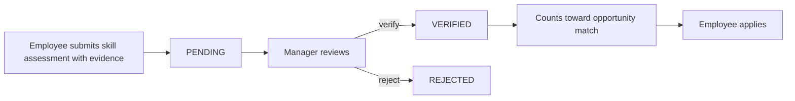

# SkillBridge API

**Evidence-backed skills and internal opportunities.** Employees prove what they can do, managers verify it, and internal roles are matched against *verified* skills only.

   

Built for **BuildLab Stage 1 (Backend Development)** by ANTHONY JERRY K. Everything runs locally: no cloud accounts, API keys or third-party services.

## The problem
Employees have no transparent path to internal growth, and hiring managers cannot tell who is qualified because skills are self-reported, unverified and scattered across records. SkillBridge makes a claim count only after someone else has verified the evidence.

## How it works


## Project status (Week 1, in progress)
| Area | State |
|---|---|
| Design: one-pager, work plan, ERD, API spec, business rules | Done, see [documentation](#documentation) |
| Application skeleton, PostgreSQL in Docker, Flyway schema (V1 core tables, V2 assessment history) | Done, verified on a fresh database |
| Skill assessment CRUD endpoints | Being implemented |
| Authentication, verification, opportunities, applications | Planned for Week 2 |
| Tests, OpenAPI docs, deployment | Planned for Week 3 |

## Quick start

**Requirement:** [Docker Desktop](https://www.docker.com/products/docker-desktop/), running. Nothing else: no JDK, Maven or PostgreSQL. The first build needs internet and takes several minutes (it downloads images and dependencies), so don't stop it if it looks quiet. Later starts take seconds. Ports **8080** (API) and **5433** (database) must be free.

### Option 1: Docker only (recommended)
```bash
git clone https://github.com/Antonijerry/skillbridge-api.git
cd skillbridge-api
cp .env.example .env        # Windows: copy .env.example .env
docker compose up --build
```
When the log shows `Started SkillbridgeApiApplication`, the application is listening on **http://localhost:8080** and its database schema is created. The `.env` values are local dummy values and work as they are.

### Option 2: Run from source (developers)
Requires JDK 21 and Docker.
```bash
cp .env.example .env        # Windows: copy .env.example .env
docker compose up -d db
./mvnw spring-boot:run      # Windows: mvnw.cmd spring-boot:run
```

Stop everything with `docker compose down`. Add `-v` to also delete the local database.

## Planned API (Week 1 scope)
| Method | Path | Purpose |
|---|---|---|
| POST | `/api/skill-assessments` | Claim a skill with evidence |
| GET | `/api/skill-assessments` | List, filter by `employeeId`, `skillId`, `status` |
| GET | `/api/skill-assessments/{id}` | Get one |
| PUT | `/api/skill-assessments/{id}` | Revise a claim while PENDING |
| DELETE | `/api/skill-assessments/{id}` | Withdraw a claim while PENDING |
| GET | `/api/skills` | Read-only skill catalogue |

Every error will use one format, `{ "error": { "code", "message", "details?" } }`, and no response will expose a stack trace. Full contract: [`docs/api-spec.md`](docs/api-spec.md).

## Data model


Six entities: Employee, Skill, SkillAssessment, Opportunity, OpportunityRequirement, Application. Opportunity-to-Skill and Employee-to-Opportunity are many-to-many, through `opportunity_requirements` and `applications`. The current schema creates the first three tables; the rest arrive in a Week 2 migration.

## Engineering decisions
- **The database enforces the rules too.** At most one open (PENDING) claim per employee and skill (a partial unique index; history is kept), no self-review and the review-state rules are UNIQUE and CHECK constraints, so bad data cannot get in even if application code has a bug.
- **Verified claims are never edited.** VERIFIED and REJECTED assessments are immutable history; a rejected employee resubmits, and a higher level is a new claim, so no one can promote themselves without review.
- **Flyway owns the schema.** Hibernate only validates it (`ddl-auto: validate`). Schema changes are new migrations, never edits to an applied one.
- **Layered, package-by-feature structure.** Controller, service and repository per feature; DTOs at the API boundary, entities never exposed.
- **Secrets stay out of Git.** Configuration comes from environment variables; only `.env.example` is committed.

More in [`docs/design-decisions.md`](docs/design-decisions.md) and [`docs/business-rules.md`](docs/business-rules.md).

## Configuration
| Variable | Meaning | Default in `.env.example` |
|---|---|---|
| `DB_NAME` | Database name | `skillbridge` |
| `DB_USER` | Database user | `skillbridge` |
| `DB_PASSWORD` | Database password (local dummy value) | `local_dev_password` |
| `DB_PORT` | Host port for PostgreSQL (5433 avoids clashing with a local PostgreSQL on 5432) | `5433` |

## Troubleshooting
| Problem | Fix |
|---|---|
| `Bind for 0.0.0.0:8080 failed: port is already allocated` | Something else uses port 8080. Run `docker compose down` in any older copy of this project, or stop the program using 8080 (`netstat -ano \| findstr :8080` on Windows), then start again |
| `port is already allocated` for the database | Change `DB_PORT` in `.env` to a free port, then `docker compose down` and start again |
| `password authentication failed` | Either you changed `DB_PASSWORD` after the first start (run `docker compose down -v`, which deletes only the local database), or another PostgreSQL is using your `DB_PORT` |
| Docker command not found or engine error | Start Docker Desktop and wait until it reports running |
| `Cannot resolve placeholder 'DB_USER'` (Option 2) | Create `.env` from `.env.example` in the repo root |

## Documentation
[One-pager](docs/idea-one-pager.md) · [Work plan](docs/work-plan.md) · [ERD](docs/erd.md) · [API spec](docs/api-spec.md) · [Business rules](docs/business-rules.md) · [Design decisions](docs/design-decisions.md)
